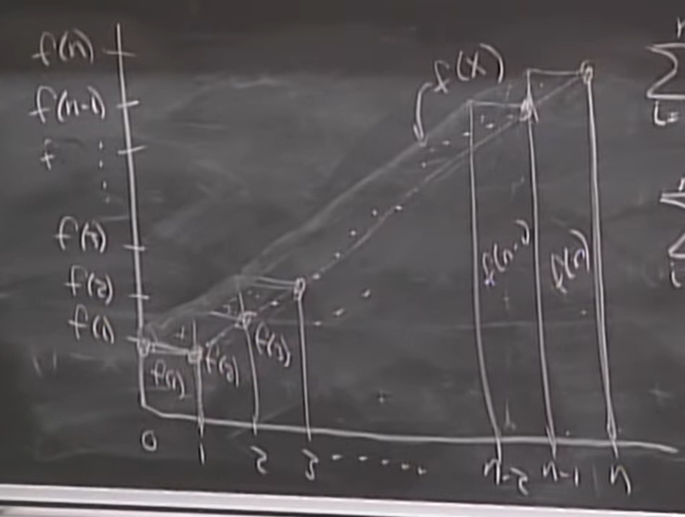

# Lecture 12 - Sums

The first half of the lecture was deriving the formulas for $ \sum_{i}^{n-1}{i} $ and $ \sum_{i}^{n-1}{i^2} $

## Derivative method for calculating sums

To derive the closed form expression for a sum which you don’t know, look for a sum with a similar general term for which you do know the closed form and differentiate it.

$$ \sum_{i=1}^{n}{ir^i} = r\sum_{i=1}^{n}{\frac{d}{dr}r^i} = r\frac{d}{dr}\sum_{i=1}^{n}{r^i} = r\frac{d}{dr}\left(\frac{1-r^n}{1-r}\right) $$

## Integration Bounds on Sums

Not all sums have closed forms. For sums that don’t have closed bounds, like $\sum_{i=1}^{n}{\sqrt{i}}$, we can use integration to estimate bounds on those sums within reasonable error. Let’s say we want an estimate for a sum without a closed bound representation.

$$ \sum_{i=1}^{n}{f(i)} $$

If we draw a histogram of all the terms in the sum, we get  

Here n is on the x axis and f(n) is on the y axis. Then, the sum is bounded below by

$$ \sum_{i=1}^{n}{f(i)} \geq f(1) + \int_{1}^{n}{f(x) dx} $$	

This is easy to see from the graph. However, this only works if ***f is an increasing function***. Similarly, the sum is bounded from above by

$$ \sum_{i=1}^{n}{f(i)} \leq f(n) + \int_{1}^{n}{f(x) dx} $$

So the two bounds for the sum are   

$$ f(1) + \int_{1}^{n}{f(x) dx} \leq \sum_{i=1}^{n}{f(i)} \leq f(n) + \int_{1}^{n}{f(x) dx} $$

These bounds differ by f(n) \- f(1), which will increase as n increases. However, the integral term in the bound will increase much faster than this “error” term, so these bounds are still good. For our square root sum example, the error term increases proportional to sqrt(n), but the sum itself increases to the order of n3/2. We can express this as \-

$$ \sum_{i=1}^{n}{f(i)} = \int_{1}^{n}{f(x) dx} + \delta(n) $$

Where $\delta(n)$ is

$$ \delta(n) = f(n) - f(1) $$

Since this becomes insignificant w.r.t. $\int_{1}^{n}{f(x)dx}$ as n goes to infinity, we write that this sum can be approximated as $\int_{1}^{n}{f(x)dx}$ in formal notation as \-

$$ \sum_{i=1}^{n}{f(i)} \sim \int_{1}^{n}{f(x) dx} $$

This is formal notation, which does not mean the same as “is approximately equal to”. Formally, we write

$$ f(x) \sim g(x) ~\text{if and only if}~ \lim_{x\rightarrow \infty}{\frac{g(x)}{f(x)} = 1} $$

This was for increasing functions. By a similar derivations, we can come up with the following bounds for decreasing functions \-

$$ f(n) + \int_{1}^{n}{f(x) dx} \leq \sum_{i=1}^{n}{f(i)} \leq f(1) + \int_{1}^{n}{f(x) dx} $$

It’s the same expression with f(1) and f(n) switched. This is easy to derive once you know how you derived the first inequality, so I won’t write a proof for it here.
