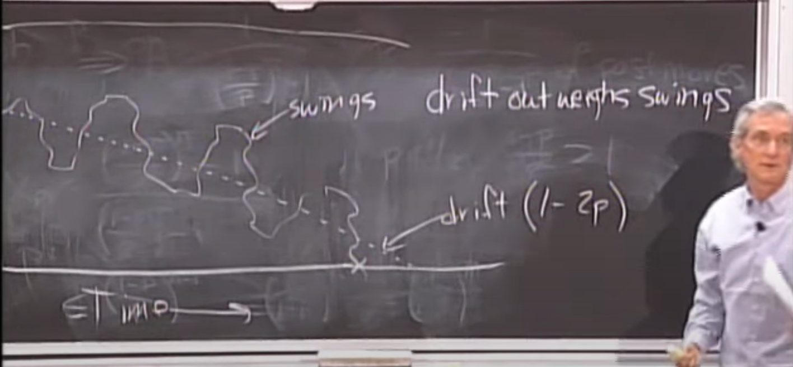

# Lecture 25 - Random Walks

Let’s look at a game in which you either win a dollar with probability p or lose a dollar with probability 1-p, and you keep playing until you either gain m dollars or lose all n dollars you came with. We want to analyze the probability that you stop playing because you gained m dollars.

This analysis can be applied to any game to analyze your chances of winning, and also to decide whether you should be playing this game or not.

## Random Walks

A random walk is a situation where you’re looking at a quantity, the amount of money you have in total, for example, and that quantity changes each time you do something. This specific situation is a one dimensional random walk because we only have one variable we are keeping track of.

In our situation, the amount of money we have either goes up by one with probability p or goes down by 1 with probability 1-p. If we consider a game like roulette, p is around 0.473, and each round of the game is mutually independent of all others. Such a random walk in which all events are independent are called a martingale.

The random walk is said to be biased if p is not ½.

## Roulette Random Walk

Roulette is the game where you have a spinning disc thing with 18 black stops, 18 red stops, and 2 green stops. You win if the ball lands on a red stop. The probability of winning is 9/19 (easy to see how).

Let’s say you come to the casino with n dollars and aim to win m dollars before you quit (or lose all n dollars). We want the probability that we will win m dollars and not lose all n.   
Let’s define Xn to be the probability that we win when we come to the casino with n dollars. Since each round of the game is mutually independent of every other round, we can come up with a recurrence for Xn.

$$X_n=p X_{n+1}+(1-p) X_{n-1}$$

You can prove this recurrence by actually doing the math, but the intuition is that since all rounds of the game are independent, the probability of winning if you start with n dollars is the same as winning the first round, and then winning as if you had started with n+1 dollars, or losing the first round and then winning as if you had started with n-1 dollars. This is because the union of these two outcomes is exhaustive of all the outcomes of the first round.

We solve this recurrence by simplifying the recurrence in terms of Xn+1 and then solving for Xn using the techniques given in lecture 15\.

$$Xn=\frac{(\frac{1-p}{p})^n-1}{(\frac{1-p}{p})^T-1}$$

Approximating and assuming p \< ½,

$$Xn \leq \left(\frac{p}{1-p}\right)^{T-n} = \left(\frac{p}{1-p}\right)^m$$

If we substitute roulette’s value of 0.473, we get that the chance of winning 100 dollars before you lose your 1000 is 2.01e-5, which is around 1 in 37,648 (m \= 100, p \= 0.473).

Also, Xn does not depend on the amount you start with\! The intuition behind this is that we are actually just calculating the probability that we will get m more wins than losses, which does not depend on the amount you start with. If you start with more, the game may last longer, but you still need 100 more wins than losses, and since each round of the game does not care about how many previous rounds have been played, the probability does not depend on how much you start with.

## Drift and Swing

If we plot our one dimensional random walk w.r.t time (or the number of games played), keeping the amount of money we have on the y axis and the number of games played on the x axis, the graph looks something like this \-

The dotted line is called the “drift”, and it is the baseline or the amount of money we expect to have left as the game progresses. In roulette, we expect to lose a small amount of money in each game, so we drift downwards each step forward. The drift here is (1-2p). The drift is calculated as the expected loss in each step. In roulette, we lose 1 dollar with probability (1-p) and we gain a dollar with probability p. So the expected loss in each step is

$$Ex(loss)=1(1-p)-1(p) =1-2p$$

The swings are our oscillations about the drift as we win and lose individual games.

## Expected Length of Walk

Let us define En as the expected number of steps we take before the game ends, given that we start with n dollars.  

$$E_n=Ex(S | D=n)$$

Where S is the number of steps we take till we either run out of money or reach our goal of n+m dollars, and D is the amount we start with.

Using the exact same analogy as we did for the recurrence before, we can prove that the recurrence for En is \-

$$E_n=1+p(E_{n+1}) +(1-p)E_{n-1}$$

En is 0 when n is either 0 or n+m, which are our boundary conditions.

This recurrence is non-homogenous. Solving it using the techniques given in lecture 15, we get the solution of the recurrence as (for p  ½) \-

$$E_n = \frac{n}{1-2p} - \frac{n+m}{1-2p}\left(\frac{\left(\frac{1-p}{p}\right)^n-1}{\left(\frac{1-p}{p}\right)^{n+m}-1}\right)$$

This solution looks complicated, but the entirety of the second term vanishes really fast for even small differences in n and n+m. Intuitively, if your expected loss after each step is 1-2p, you could guess that the number of steps it takes you to lose n dollars is n/1-2p, and you would be really close. For the roulette example with p \= 0.473, n \= 1000, and m \= 100, En is 18,999.44 if you substitute the values in, and your intuition would give you 19,000.