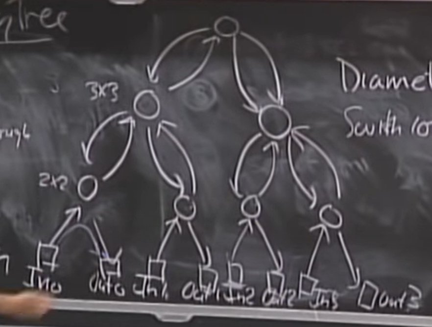
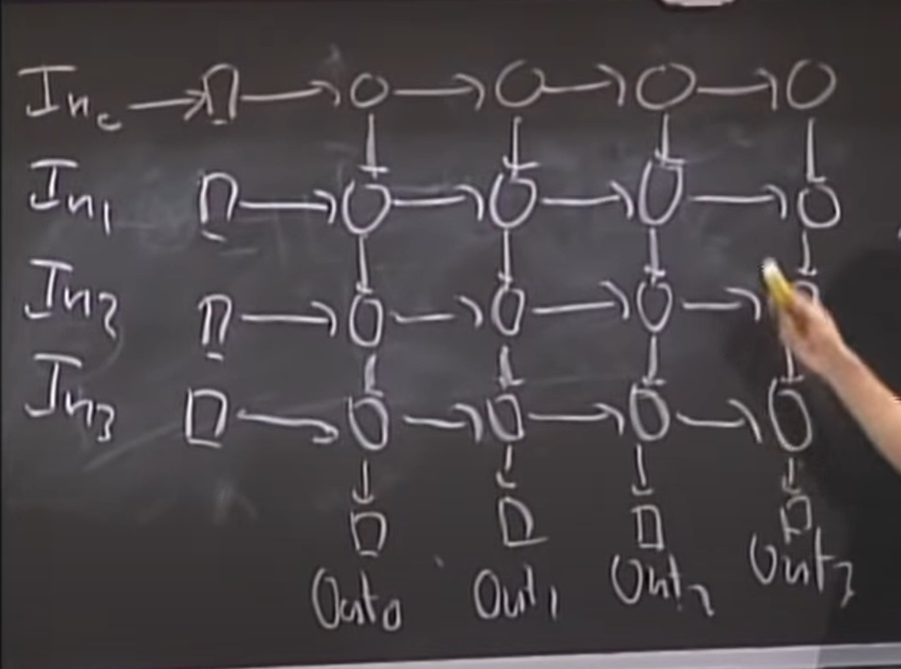
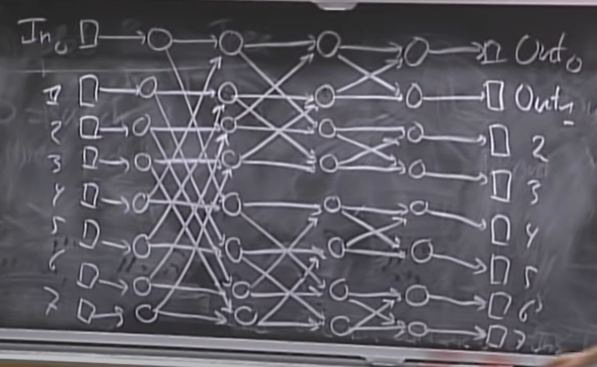
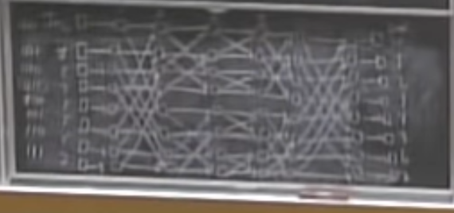

# Lecture 9 - Communication Networks
Communication networks are networks which can communicate with all the terminals connected to the network. They can take input from a terminal and output to a terminal. The job of taking input and giving output is handled by ‘switches’. Our job is to figure out the best architecture in which to arrange these switches such that some parameters are optimized.

## Definitions

* A switch is defined as a place where a terminal can give data input to or take data output from.
* A terminal is a device connected to the network that is the source or destination of data.
* Latency is the time taken by a packet to travel from an input to an output. We can measure this in our case by measuring the number of wires the packet has to go through.
* The diameter of an architecture is the length of the shortest path from an input to an output that are furthest apart.
* The switch size is the number of inputs to a switch x the number of outputs from a switch.
* A permutation is a function  from the set {0, …, n-1} to {0, …, n-1} such that no 2 i and j numbers are mapped to the same value. That is, (i) \= (j) iff i \= j.
* The permutation routing problem is a problem in which we have to route a packet from input i to output (i) for all i.
* A path taken by a packet is the sequence of switches the packet has to travel through, denoted by P(i, (i))
* The congestion in an architecture is defined as the largest number of paths that pass through a single switch in the worst case.

## Data Structures/Architectures

### Binary Trees

The parameters for a communication network with a binary tree architecture are (n is the number of inputs/outputs) \-  

| Diameter       | Switch Size | \# Switches | Congestion |
|:---------------|:------------|:------------|:-----------|
| $2\*(1+lg(n))$ | 3x3         | 2n-1        | n          |

In a binary tree architecture, the root of the tree is the most vulnerable node, and, if failed, will result in the 2 halves of the tree being disconnected entirely.

### 2D Array

The circles are the switches and the squares are the inputs/outputs

| Diameter | Switch Size | \# Switches | Congestion |
|:---------|:------------|:------------|:-----------|
| $2n$     | 2x2         | n2          | 2          |

It can be proved that the congestion of a 2D array structure is 2 for any number of switches or inputs.

### Butterfly Network

The butterfly network is a combination of both the binary tree structure and the 2D array structure. It combines the parameters of both the networks to try to achieve the best of both.   

There are lg(n) columns and n rows in the architecture.

| Diameter   | Switch Size | \# Switches | Congestion |
|:-----------|:------------|:------------|:-----------|
| 2 \+ lg(n) | 2x2         | n (1+lg(n)) | n          |

### Benes Network

We get a benes network if we continue the butterfly network and replicate it on the right side before attaching the outputs.

| Diameter        | Switch Size | \# Switches    | Congestion |
|:----------------|:------------|:---------------|:-----------|
| $1 \+2\* lg(n)$ | 2x2         | $2n (1+lg(n))$ | 1          |